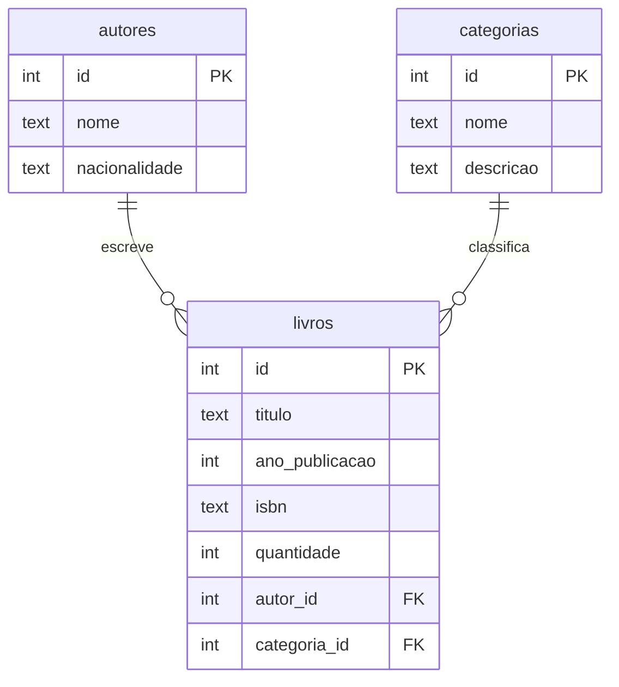

# Sistema de Biblioteca (Flask + SQLite)

## Como executar
```
pip install -r requirements.txt
python app.py
```
Acesse http://127.0.0.1:5000. Se `biblioteca.db` não existir, ele é criado a partir de `schema.sql` (com dados de exemplo).

## Diagrama das tabelas


## Rotas
| Rota | Função |
|---|---|
| `/` | Página inicial |
| `/livros` | Consulta do acervo (com busca) |
| `/livros/cadastrar` | Cadastro de livro |
| `/livros/<id>/editar` | Edição (desafio extra) |
| `/livros/<id>/excluir` | Exclusão (desafio extra) |
| `/autores`, `/autores/cadastrar` | Autores |
| `/categorias`, `/categorias/cadastrar` | Categorias |
| `/teste-banco` | Testa a conexão |

## Fluxo
HTML (formulário) → Flask (rota) → SQLite (INSERT/SELECT) → Flask → HTML (Jinja2)

## Entrega
Prints das telas e do banco no DBeaver (nova conexão SQLite apontando para `biblioteca.db`; clique direito em `livros` → View Diagram).
